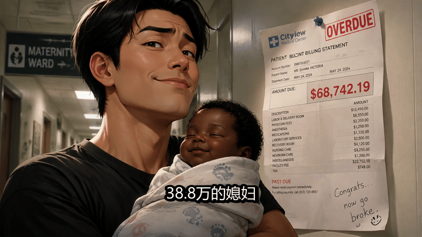

# 🎬 AI-ShortVideo-Story-Engine (AI短视频剧情全流程生成引擎)

<div align="center">

[](https://opensource.org/licenses/MIT)
[](https://github.com/slad-dev/AI-ShortVideo-Story-Engine/pulls)
[](https://github.com/slad-dev/AI-ShortVideo-Story-Engine)
[](https://github.com/slad-dev/AI-ShortVideo-Story-Engine)

**⚡ 一句话输入，端到端生成即发级短视频全案：黄金3秒钩子 + 人生副本/商业反转剧本 + 16:9纯漫分镜Prompt + 配音与声画对齐施工表 + 抖音/小红书双端发布包！**

<p align="center">
  
  
</p>

> 🎬 **实测成品视频观看**：本项目包含由本 Skill 完整产出的 3 分钟实战成片（1080P）！  
> - 仓库内轻量高清版：[assets/demo_story_1080p.mp4](assets/demo_story_1080p.mp4)  
> - Release 原画级母版下载：[GitHub Release v1.0.0 页面](https://github.com/slad-dev/AI-ShortVideo-Story-Engine/releases/tag/v1.0.0)

[English Documentation](README_EN.md) · [极速上手指南](QUICKSTART.md) · [提 Issue / 反馈](https://github.com/slad-dev/AI-ShortVideo-Story-Engine/issues)

</div>

---

## 💡 为什么开源这个项目？（痛点直击）

目前市面上大部分“AI一键生成短视频”工具或提示词，往往存在致命问题：
1. **假大空口播，毫无留存**：开场大段自我介绍或说教，前3秒直接劝退观众；
2. **画面变成PPT幻灯片**：遇到数字、概念就给黑底大字或柱状图，彻底失去电影感与代入感；
3. **音画脱节与镜头死板**：旁白念完了字幕还在飘，图片毫无景别和情绪节奏；
4. **剧情平铺直叙，缺乏张力**：没有压力阶梯、没有伏笔回收，沦为流水账。

**本项目是我深度逆向全网头部爆款短视频（商业博弈/人生副本/防坑反杀/商业模式拆解）后，精心蒸馏提炼的一套工业级 AI 短视频生成引擎（Agent Skill 标准架构）。**

> 📢 **开源心里话**：  
> 这套 Skill 现在的强项在于：**你给它一句话，它就能自动化补全配音台词、剪辑施工表、分镜Prompt、黄金3秒等一整套完整落地工程**！  
> 但诚实地讲，在极端复杂的长线剧情深度和多重悬疑反转上，它有时仍显得不够完美。我决定将这套经过实战打磨的核心资产**完全开源**，给广大创作者与开发者提供一个扎实的底座与思路，更期待社区小伙伴们一起提 PR，共同打磨出最强的开源短视频故事大脑！如果觉得有用，**请顺手点个 ⭐️ Star 支持一下！**

---

## 🔥 核心特性一览

| 模块 | 核心能力 | 解决的传统痛点 |
| :--- | :--- | :--- |
| **🎯 黄金3秒钩子引擎** | 内置 5 大爆款开头范式（金钱诱惑+灾难后果、熟人背叛、假便宜、身份逆转、隐形定时炸弹） | 解决 0-3 秒观众滑走跳出问题 |
| **🎭 故事先导 (Story-First)** | 强制先构建故事契约（情绪承诺、权力对抗、核心反转、贯穿物、3条伏笔回收表）再写分镜 | 彻底杜绝无病呻吟与逻辑崩塌 |
| **🎨 16:9 纯漫视觉标准** | 坚决禁止 PPT 式大字报！商业数据与数字全部“具象物化”融入动漫世界（如工资条、POS机、房租账单） | 彻底摆脱劣质PPT风，电影级沉浸感 |
| **⏱️ 5-8秒镜头与剪辑律动** | 严格遵循单镜头 5-8 秒刷新率；杜绝镜头瞎晃，标定镜头运动（推镜头/定格/硬切/叠化） | 节奏紧凑，保持多巴胺高频刺激 |
| **🎙️ 声画毫秒级对齐规范** | 明确 TTS 语音生成与字幕时间轴对齐规则，杜绝字幕残留超过 150ms 与累积漂移 | 彻底解决配音念完字幕还在飘的业余感 |
| **📱 抖音/小红书双端分发** | 自动输出抖音快节奏版（完播率导向）与小红书深度版（收藏锚点+独立封面设计） | 告别一套文案生搬硬套全网的低效运营 |

---

## 📐 仓库架构

本项目完全遵循标准化 Agent Skill 体系设计，开箱即用：

```text
AI-ShortVideo-Story-Engine/
├── skills/
│   ├── douyin-script/                     # 核心：人生副本脚本工厂
│   │   ├── SKILL.md                       # 主技能定义与生产流水线
│   │   ├── agents/openai.yaml             # Agent 对齐接口
│   │   └── references/
│   │       ├── hook-bank.md               # 爆款开头黄金钩子库
│   │       ├── story-engine.md            # 电影级叙事与反转引擎
│   │       ├── story-factory.md           # 批量故事工厂与压力阶梯
│   │       ├── archetype-longform.md      # 5-10分钟人物一生长片模型
│   │       └── competitor-teardown.md     # 对标爆款视频逆向拆解法
│   └── explain-commercial-models/         # 进阶：商业模式拆解与博弈引擎
│       ├── SKILL.md                       # 商业机制深度剖析与留存诊断
│       ├── agents/openai.yaml             # Agent 对齐接口
│       └── references/
│           ├── audio-subtitle-sync-postmortem.md   # 声画同步与剪辑避坑血泪史
│           ├── domestic-retention-diagnostics-douyin-xhs.md # 双端留存漏斗诊断
│           ├── immersive-second-person-and-shot-rhythm.md   # 第二人称沉浸式节奏
│           ├── business-thinking-playbook.md       # 商业思维与现金流沙盘
│           └── ... (历史/现代爆款商业案例库)
├── QUICKSTART.md                          # 极速上手提示词与实战全流程
├── scripts/
│   └── batch_video_pipeline.py            # (规划/示例) 自动化解析并对接TTS与生图
└── README.md
```

---

## 🚀 极速部署与使用指南

无论你使用什么 AI 工具，本引擎都可以轻松接入：

### 方案 1：Claude Code / Codex / Antigravity (原生推荐)
直接将本项目的 `skills/` 文件夹复制到你的 Skill 配置目录即可：
```bash
# 克隆仓库
git clone https://github.com/slad-dev/AI-ShortVideo-Story-Engine.git

# 复制到你的 skills 目录（以常见路径为例）
cp -r AI-ShortVideo-Story-Engine/skills/* ~/.codex/skills/
# 或复制到 Antigravity / Claude Code 的 skills 目录
```
**启动口令**：
> “使用 `douyin-script`，帮我写一个关于‘小县城青年加盟奶茶店负债50万反杀’的16:9横屏动画短视频全案。”

---

### 方案 2：ChatGPT / Claude Web / DeepSeek (零代码网页端)
1. 打开 `skills/douyin-script/SKILL.md`；
2. 将文件内容复制并粘贴到 **ChatGPT 定制 GPTs (Instructions)** 或 **Claude Project (项目知识)**，或直接作为对话背景 Prompt 发送；
3. 直接输入你的题材（例如：“实体店倒闭潮下的二手设备回收商传奇”），即可获得全流程分镜与剧本！

---

### 方案 3：Cursor / Windsurf / VS Code
把本项目放到项目根目录下，在 `.cursor/rules` 或工作区直接引用 `skills/douyin-script/SKILL.md`，即可在编辑器内与 AI 协同编剧！

---

### 方案 4：Dify / Coze 智能体接入
1. 在 Dify / Coze 中新建 Prompt 编排型 Agent；
2. 将 `douyin-script/SKILL.md` 的内容填入 System Prompt；
3. 将 `references/` 目录下的 Markdown 文件上传至知识库（Knowledge Base）开启召回检索；
4. 即可在前端搭建出属于你自己的商业级短视频生成 Web 应用！

---

## 🎬 实际输出样例效果 (Sample Output)

当你输入一句话：“`写一个关于外卖小哥发现平台算法漏洞反向破局的故事`”，引擎将自动输出符合以下规范的交付包：

<details>
<summary><b>👉 点击展开：查看标准化输出结构预览</b></summary>

```markdown
# 人生副本脚本：算法之外的第36号订单

## 故事引擎卡
- 情绪承诺：憋屈反杀
- 一句话前提：外卖骑手小李偶然发现系统派单漏洞，在封号倒计时的48小时内完成逆袭
- 贯穿物件：一部碎屏的备用二手机（欲望 -> 代价 -> 翻盘底牌）
- 核心反转：原本以为是平台监控系统惩罚，实则是算法推荐机制被反向训练
- 伏笔回收表：
  1. 伏笔：第1镜中被淋湿的防雨手机套 -> 回收：第7镜成为隔绝电磁干扰的关键道具

## 黄金3秒候选
1. “送外卖第三年，我偶然卡出平台bug，单日提现了过去三个月的收入。”
2. “你以为被算法玩弄的是骑手，直到我把这串代码倒过来输入。”
3. “平台以为我是最听话的五星骑手，直到后台数据被一个碎屏手机击溃。”

## 正片分镜与生图提示词 (16:9 纯漫标准)
| 时间 | 动画画面/商业信息场景化 | 旁白 | 字幕 | 镜头运动 |
| :--- | :--- | :--- | :--- | :--- |
| 0-3s | 暴雨夜，外卖箱反光，碎屏手机屏幕泛着绿色代码与提现倒计时 | 送外卖第三年，我偶然发现了系统派单的致命漏洞。 | 致命漏洞 | opening entrance |
| 3-8s | 骑手在逼仄的出租屋，墙上贴满带红叉的外卖扣款单与路线图 | 你每天跑够14个小时，却发现扣款单上的数字比工资涨得更快。 | 为什么越跑越穷？ | static |

## 剪辑与声音工程
- BGM：低频心跳脉冲 -> 反转处切换为节奏感强烈的合成器电音
- 字幕与TTS：0.2s内启动无前戏，单句严格控制在150ms以内收尾
- 双平台发布包：附带抖音完播型标签与小红书独立封面设计
```
</details>

---

## 🗺️ 路线图 (Roadmap)

- [x] **v1.0**: 蒸馏开源核心双引擎（`douyin-script` + `explain-commercial-models`）与全套爆款参考知识库
- [x] **v1.1**: 支持 Claude Code / Antigravity / Cursor / Dify 等多 Agent 平台无缝接入标准
- [ ] **v1.2 (进行中)**: 编写一键合成流水线脚本（自动调用 Edge-TTS 生成配音、Whisper 对齐字幕、ComfyUI / Midjourney API 批量出图）
- [ ] **v2.0**: 强化反转剧情模型（深度引入编剧三幕式与更复杂的现代悬疑商战剧本库）
- [ ] **v2.1**: 发布轻量级 Web 交互界面 (Streamlit / Gradio)

---

## 🤝 诚挚邀请共建 (Contributing)

短视频内容工业正在经历一场由 AI 驱动的革命，个人的视角终归有限。如果你：
- 擅长**编剧剧情与多重反转设计**，欢迎补充更炸裂的 `story-engine.md` 模板！
- 擅长**提示词工程与画风控制**，欢迎贡献针对 Midjourney v6 / Flux / SDXL 的高精度风格提示词！
- 擅长**工程化与工作流**，欢迎贡献自动调用剪映、Edge-TTS 或 MoviePy 的代码脚本！

随时欢迎提交 [Pull Request](https://github.com/slad-dev/AI-ShortVideo-Story-Engine/pulls) 或 [Issue](https://github.com/slad-dev/AI-ShortVideo-Story-Engine/issues)！

---

## 📄 开源协议

本项目采用 [MIT 许可证](LICENSE)，免费用于个人及商业用途。

---

<div align="center">

如果这个项目对你的内容创作或灵感启发有所帮助，请为它点一个 ⭐️ **Star** 鼓励一下吧！

</div>
